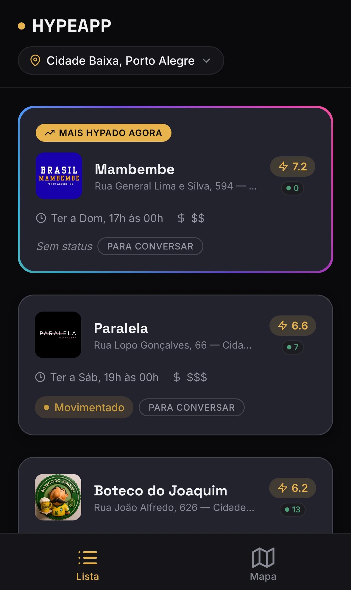
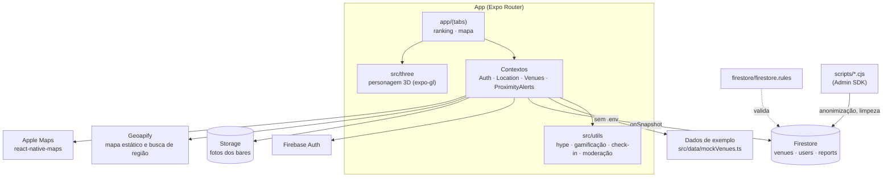

<div align="center">

# 🍻 HypeApp

**O "Waze do rolê": o hype de cada bar da Cidade Baixa em tempo real, com notas de 0 a 10 dadas por quem já está lá.**

[](https://github.com/GabrielPMachado/HypeApp/actions/workflows/ci.yml)


[](https://www.conventionalcommits.org/pt-br/v1.0.0/)


[Arquitetura](#arquitetura) · [Como rodar](#como-rodar) · [Testes](#testes-e-ci) · [English](#english)

</div>

<p align="center">
  
  <br />
  <sub>O HypeApp numa tela de iPhone: ranking dos bares da Cidade Baixa e troca de região. Gravado da versão web do app (Expo), com os dados de exemplo do projeto.</sub>
</p>

> Descubra exatamente onde está o "hype" da noite antes de sair de casa. Sem surpresas, sem filas inesperadas e com a música certa para a sua vibe.

## Sumário

- [O problema](#-o-problema)
- [A solução](#-a-solução)
- [Recursos](#recursos)
- [Arquitetura](#arquitetura)
- [Stack](#stack)
- [Estrutura de pastas](#estrutura-de-pastas)
- [Como rodar](#como-rodar)
- [Testes e CI](#testes-e-ci)
- [Decisões técnicas](#decisões-técnicas)
- [Estratégia e modelo de negócio](#estratégia-e-modelo-de-negócio)
- [Padrão de commits e versões](#padrão-de-commits-e-versões)
- [Licença](#licença)
- [English](#english)

## 💡 O problema

Sexta-feira à noite, você e seus amigos querem tomar uma cerveja e ouvir uma música legal, mas surge a dúvida: *para onde ir?* Ir aos mesmos lugares de sempre pode ser monótono, mas testar um lugar novo às escuras é arriscado. E decidir pelas redes sociais muitas vezes cai em publicidade paga, que perde a essência real da noite.

## 🚀 A solução

O **HypeApp** é um aplicativo colaborativo em tempo real que funciona como um "termômetro do hype" autêntico. A própria comunidade que já está nos bares mostra o que está acontecendo na cidade *agora*, sem filtros comerciais.

## Recursos

- 🗺️ **Mapa e ranking:** os bares mais quentes no Apple Maps ou em lista, com troca de região e busca livre
- ⚡ **Hype em dois toques:** quem está no bar dá a nota da noite; ela perde valor com o tempo e zera todo dia ao meio-dia
- 🟢🟡🔴 **Lotação rápida:** vazio, animado ou lotado, com indicadores visuais
- 🎸 **Filtros por vibe e estilo:** rock, samba, eletrônica, "para conversar", "para dançar"
- ⭐ **Avaliações e fotos** de cada bar, enviadas pela comunidade
- 🏆 **Gamificação (Especialistas da Noite):** pontos por hype e avaliação, níveis, moedas e uma loja de itens
- 🧍 **Personagem 3D** personalizável (Three.js), usado como avatar no perfil
- 👥 **Perfis públicos**, seguir e seguidores
- 🔔 **Alertas de proximidade** quando um bar a até 500 m de você está bombando
- 🛡️ **Moderação**, denúncias e exclusão de conta com anonimização
- 🔐 Login com e-mail e senha ou Google

## Arquitetura

O app é um cliente Expo que fala direto com o Firebase. Não há servidor próprio: as **regras do Firestore** são a camada de segurança e validam pontuação, loja e limites de envio.



**Como a nota do hype é calculada** (`src/utils/hype.ts`): cada envio vale integralmente por 30 minutos, depois perde 1 ponto a cada 30 minutos; sem envios por 2 horas a nota zera, e o "dia de hype" recomeça às 12h. Uma mesma pessoa só pode mandar outro hype para o mesmo bar depois de 30 minutos, e isso é conferido também nas regras do Firestore.

## Stack

| Camada | Tecnologias |
| --- | --- |
| App | Expo SDK 57, React Native 0.86, React 19, TypeScript, Expo Router |
| Interface | Reanimated 4, Gesture Handler, Bottom Sheet, Linear Gradient, Haptics, fontes Inter e Space Grotesk |
| 3D | Three.js renderizado com `expo-gl` |
| Mapas e local | Apple Maps (`react-native-maps`), `expo-location`, [Geoapify](https://www.geoapify.com/) |
| Back-end | Firebase Authentication, Cloud Firestore, Cloud Storage |
| Testes | Jest com `jest-expo` |
| Processo | Husky, commitlint, commit-and-tag-version (changelog e versão automáticos) |

## Estrutura de pastas

```
.
├── .github/workflows/ci.yml   # tipos, testes e build web em todo push e PR
├── .husky/                    # valida a mensagem de commit
├── app/
│   ├── _layout.tsx            # provedores e navegação raiz
│   └── (tabs)/                # ranking (index) e mapa (mapa / mapa.web)
├── assets/                    # ícone, splash e imagens
├── docs/                      # animação do README
├── firestore/firestore.rules  # regras de segurança e validação
├── scripts/                   # tarefas administrativas (Admin SDK) e de release
├── src/
│   ├── components/            # cards, sheets, modais, avatar, loja…
│   ├── constants/             # textos legais, moderação, tags de vibe
│   ├── context/               # Auth, Location, Venues, ProximityAlerts
│   ├── data/                  # bares de exemplo, catálogo da loja, personagem
│   ├── services/              # firebase.ts, geocoding.ts
│   ├── theme/                 # cores e tipografia
│   ├── three/                 # modelo 3D do personagem
│   ├── types/                 # tipos de bar e localização
│   └── utils/                 # hype, nota, gamificação, geo, check-in…
├── app.config.js              # configuração do Expo (iOS e web)
└── commitlint.config.js
```

## Como rodar

### Pré-requisitos

- [Node.js](https://nodejs.org/) 20+
- Um Mac com Xcode e um iPhone (ou o simulador) para o app nativo
- Opcional: um projeto Firebase e uma chave da Geoapify

### Instalação

```bash
git clone https://github.com/GabrielPMachado/HypeApp.git
cd HypeApp
npm install
```

> ⚠️ O app **não roda no Expo Go**: `react-native-maps` precisa de código nativo que o Expo Go não consegue linkar dinamicamente. É preciso um **development build** próprio (uma vez só, ou sempre que uma dependência nativa mudar):
>
> ```bash
> npx expo prebuild --platform ios
> npx expo run:ios
> ```

Depois do development build instalado no iPhone ou no simulador, o dia a dia é só:

```bash
npx expo start
```

Isso abre o Metro Bundler e mostra uma URL/QR code no terminal. Com o celular na **mesma rede Wi-Fi** do computador, abra o HypeApp já instalado (ele mesmo lista os servidores de desenvolvimento disponíveis). Não precisa reinstalar a cada mudança de código, só quando uma dependência nativa muda.

Para ver só a interface no navegador, sem Mac: `npm run web`.

### Variáveis de ambiente

Copie `.env.example` para `.env` (o arquivo nunca deve ser commitado). **Sem nenhuma variável o app funciona com os dados de exemplo**, então dá para clonar e rodar direto.

| Variável | Para que serve |
| --- | --- |
| `EXPO_PUBLIC_FIREBASE_*` | Credenciais do projeto Firebase (Auth, Firestore, Storage) |
| `EXPO_PUBLIC_GOOGLE_WEB_CLIENT_ID` | Botão "Continuar com Google" (opcional) |
| `EXPO_PUBLIC_GEOAPIFY_API_KEY` | Mapa estático do bar e busca livre de região |

### Scripts

| Comando | O que faz |
| --- | --- |
| `npm start` | Abre o Metro Bundler (`expo start`) |
| `npm run ios` | Compila e abre o app no iPhone ou simulador |
| `npm run web` | Roda a versão web |
| `npm test` | Roda os testes (Jest) |
| `npm run release` | Gera a próxima versão e o CHANGELOG a partir dos commits |

## Testes e CI

São **12 suítes e 195 testes** cobrindo a nota do hype, check-in, gamificação, avaliação, moderação, geolocalização, alertas de proximidade, o personagem 3D e a loja. Um teste lê `firestore/firestore.rules` e confere que preços e itens da loja batem com o catálogo do app, para que um lado não mude sem o outro.

O workflow [`ci.yml`](.github/workflows/ci.yml) roda em todo push na `main` e em todo pull request: `npm ci`, checagem de tipos (`tsc --noEmit`), testes e o build web (`expo export`), que garante que o bundle compila.

## Decisões técnicas

- **Funciona sem configuração.** Sem credenciais, o Firebase não é inicializado e os contextos usam os bares de exemplo. Quem clona o projeto vê o app rodando na hora.
- **Regras do Firestore como back-end.** As chaves do Firebase são públicas, então toda regra de negócio sensível (preço na loja, saldo de moedas, intervalo entre hypes, limite de avaliações) é validada nas regras, não só no app.
- **Fatos no banco, pontuação no código.** O Firestore guarda só quantos hypes e avaliações cada pessoa enviou; pontos e nível são derivados em `src/utils/gamification.ts`. Mudar um peso não exige migrar dados.
- **Nota que envelhece.** O hype perde valor com o tempo e zera ao meio-dia, para refletir a noite de hoje e não um histórico.
- **Mapa por plataforma.** `mapa.tsx` usa o Apple Maps no iPhone e `mapa.web.tsx` mostra uma alternativa na web, resolvido pelo Expo Router por extensão de arquivo.
- **Commits padronizados.** Conventional Commits validados no Husky permitem gerar versão e CHANGELOG automaticamente.

## Estratégia e modelo de negócio

<details>
<summary><b>Lançamento (MVP) e validação</b></summary>

O MVP adota hiperfoco geográfico, lançando primeiro só no bairro **Cidade Baixa (Porto Alegre)**, pela alta densidade de bares e pelo público jovem.

Parcerias com 5 a 10 bares locais:

1. **Displays com QR Code:** mesas dos bares parceiros terão QR Codes que levam ao app e estimulam a atualização do status em troca de recompensas reais (ex.: chopes liberados pelo estabelecimento).
2. **Custo de aquisição inteligente:** o bar ganha destaque gratuito temporário no mapa, e o aplicativo ganha usuários ativos e dados validados em tempo real.

</details>

<details>
<summary><b>Modelo de negócios (pós-validação, B2B)</b></summary>

1. **Hype Ads:** bares pagam para impulsionar a visibilidade no mapa e nas listas.
2. **Hype Analytics:** painel com o fluxo de pico do bar, comportamento do público e perda de fluxo para concorrentes da região.

</details>

## Padrão de commits e versões

Este projeto segue o [Conventional Commits](https://www.conventionalcommits.org/pt-br/v1.0.0/):

```
<tipo>[escopo opcional]: <descrição>

[corpo opcional]

[rodapé(s) opcional(is)]
```

**Tipos mais usados:** `feat`, `fix`, `docs`, `style`, `refactor`, `perf`, `test`, `build`, `ci`, `chore`, `revert`.

```
feat(mapa): adiciona mapa de calor em tempo real
fix(status): corrige contagem de votos duplicados
docs(readme): atualiza modelo de negócio
```

Mudanças que quebram compatibilidade usam `!` após o tipo/escopo (ex.: `feat!: ...`) ou um rodapé `BREAKING CHANGE:`. A mensagem é validada automaticamente via [commitlint](commitlint.config.js) + Husky (`.husky/commit-msg`). `npm run release` usa esses commits para subir a versão (em `package.json` e `app.config.js`) e atualizar o [CHANGELOG](CHANGELOG.md).

## Licença

Projeto de [Gabriel Pinto Machado](https://github.com/GabrielPMachado). Todos os direitos reservados.

---

## English

<details open>
<summary><b>HypeApp: the real-time nightlife thermometer</b></summary>

### About

HypeApp is a collaborative iPhone app that shows, in real time, how lively each bar in Porto Alegre's Cidade Baixa neighborhood is, with 0–10 scores given by people who are already there. No paid ads, just the crowd's view of tonight.

### Features

- Map (Apple Maps) and ranking of the hottest bars, with region search
- Two-tap "hype" score that decays over time and resets daily at noon
- Vibe and music filters, reviews and community photos
- Gamification: points, levels, coins and an item store
- Customizable 3D character (Three.js) used as the profile avatar
- Public profiles, followers, proximity alerts, moderation and account deletion

### Architecture

An Expo Router client talking directly to Firebase (Auth, Firestore, Storage). There is no custom server: **Firestore security rules** validate store prices, coin balance, posting intervals and review limits. Without credentials, the app falls back to bundled sample data, so it runs right after cloning. See the [diagram above](#arquitetura).

### Getting started

```bash
git clone https://github.com/GabrielPMachado/HypeApp.git
cd HypeApp
npm install
npx expo prebuild --platform ios && npx expo run:ios   # once: development build
npx expo start                                          # day to day
```

The app does not run in Expo Go (it needs native maps code). `npm run web` runs the web version.

| Script | Description |
| --- | --- |
| `npm start` | Start Metro |
| `npm run ios` | Build and run on iPhone or simulator |
| `npm test` | Jest test suite (195 tests) |
| `npm run release` | Bump version and update the changelog |

### CI

`ci.yml` runs type checking, the test suite and a web export on every push and pull request.

### Key decisions

- Works with zero configuration thanks to the sample-data fallback
- Security and business rules enforced in Firestore rules, since Firebase keys are public
- Only raw facts are stored; points and levels are derived in code
- Conventional Commits + commitlint for automatic versioning

### License

By [Gabriel Pinto Machado](https://github.com/GabrielPMachado). All rights reserved.

</details>
